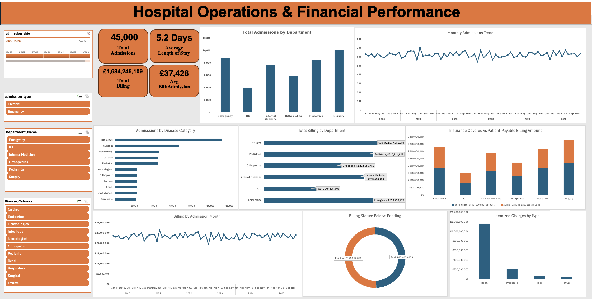

# Hospital Operations & Financial Performance Analysis

An interactive Microsoft Excel dashboard analysing hospital admissions, operational efficiency, billing activity, and financial performance from 2020 to 2025.

## Dashboard Preview

## Project Overview

This project explores hospital operational and financial performance using an integrated dataset containing 45,000 admission records.

The analysis focuses on patient admission patterns, average length of stay, departmental activity, billing distribution, insurance coverage, and payment status.

**Tools:** Microsoft Excel, XLOOKUP, PivotTables, PivotCharts, slicers, timelines, and Excel formulas.

## Data Source

**Dataset:** Hospital HMIS Dataset for Healthcare Analytics  
**Source:** [Kaggle – shalakagangurde](https://www.kaggle.com/datasets/shalakagangurde/hospital-hmis-dataset-for-healthcare-analytics/data)

This project uses a synthetic hospital management dataset obtained from Kaggle. The dataset contains simulated hospital admissions, patient information, departmental activity and billing records.

The data was integrated and analysed using Microsoft Excel. All records are synthetic and do not represent real patients or hospitals.

## Key Performance Indicators

| KPI | Value |
|---|---:|
| Total Admissions | 45,000 |
| Average Length of Stay | 5.2 days |
| Total Billing | £1,684,246,109 |
| Average Billing per Admission | £37,428 |

## Data Preparation

- Combined relevant hospital datasets using XLOOKUP to retrieve department, ward, disease, and billing information.
- Calculated length of stay from admission and discharge dates.
- Checked admission IDs for uniqueness.
- Validated the overall billing total against the original billing data.
- Created PivotTables and PivotCharts to support the interactive dashboard.

## Dashboard Analysis

The dashboard explores:

- Hospital admissions by department and disease category.
- Monthly admissions and billing trends.
- Average length of stay.
- Billing performance across departments.
- Insurance-covered versus patient-payable amounts.
- Paid versus pending billing status.
- Itemised billing charges by category.

## Key Findings

- The dataset contains 45,000 hospital admissions across the reporting period.
- Average length of stay is approximately 5.2 days.
- Total recorded billing is approximately £1.68 billion.
- Surgery has the highest total billing among the departments displayed.
- Infectious diseases account for the largest number of admissions among the disease categories displayed.

## Limitations

This is a descriptive analysis of the available hospital records. Differences in departmental billing may reflect admission volumes, patient complexity, or service types.

Billing amounts represent recorded charges and should not automatically be interpreted as collected revenue or hospital profit.

## How to Explore the Dashboard

Download the Excel workbook from this repository and open it in Microsoft Excel.

Use the interactive slicers and timeline to explore admission types, departments, disease categories, and reporting periods.
